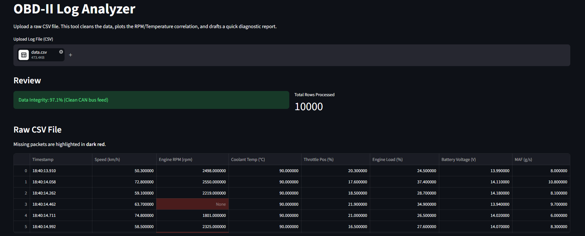
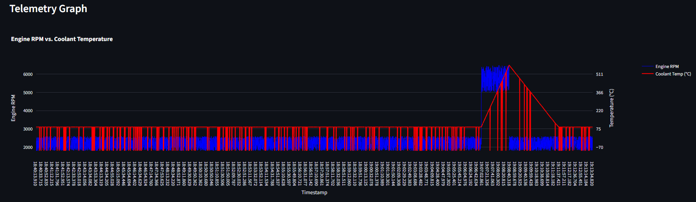
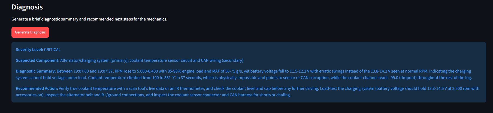

# OBD-II-Log-Analyzer

This is my first major project stepping into the automotive engineering space, following my previous IT and data work on the Partner Performance Tracker and Supplier Pricing Tool. Built on and off over about 2 weeks between September and October, this project bridges my past experience with my core interests. After my Technician summer internship at Veolia (Apa Nova București), I decided that I wanted to finally combine my background in data processing and workflow automation with my absolute passion for cars (the mechanics, the engineering, how they operate under stress). 

Whenever a manufacturer tests a vehicle, the car's CAN bus and OBD-II sensors generate massive operational logs, thousands of rows tracking RPM, coolant temperature, mass air flow, and battery voltage every few milliseconds. The issue? When a test car fails, finding the exact moment of failure by manually scrolling through tens of thousands of rows in Excel is a nightmare, in short, highly prone to human error and time wasting.

Building an automated pipeline helps QA testers and engineers immediately spot mechanical failures and dropped sensor data, saving days of manual log analysis. 

So, how does this Python project work? It ingests raw, messy OBD-II CSV logs, cleans up the missing packets, visualizes the physical correlations, and uses a filtered AI pipeline to automatically draft a structured suggestion ticket for the mechanical team.

## The logic behind it

To make sure the team can trust the data and quickly identify the fault, the script audits the file and uses a cost-effective AI filtering method.

Every uploaded file starts with a Data Integrity Check. The script calculates the total number of cells and deducts the percentage of missing packets (like a sensor shorting out or a Bluetooth logger dropping connection), giving the file an overall Integrity Score.

Instead of sending a massive 10,000-row CSV file to an AI—which is slow, expensive, and causes hallucinations, this tool uses a lightweight RAG (Retrieval-Augmented Generation) approach. It uses Pandas to filter the data, isolating only the exact seconds where a physical anomaly occurred (e.g., Coolant Temp > 100°C, or a sensor reading -99.0). It sends only this isolated slice of data to the Claude API, asking it to diagnose the fault based on the correlation between RPM, Load, and Voltage.

**But wait, you might ask yourself:** if I only slice and send the "problematic" data, won't the AI lack the baseline context to understand what normal driving looked like? Won't it just reply like a fresh, confused chat?

Well, first the Pandas filter doesn't just send the exact millisecond of failure; it is designed to grab a "time buffer" (the healthy data moments right before the temperature spikes) so the AI sees the physical transition. Second, I used a heavily structured System Prompt to "pre-train" the AI for that specific session, in short, I inject its exact persona, the strict rule-set for edge cases (like how to handle -99.0 sensor drops), and the expected output format. 

This way, the AI gets the exact mechanical context it needs to diagnose the fault—seeing the RPM climb right before the temperature spikes—without wasting 150,000 API tokens on 20 minutes of healthy highway cruising.

## Project MVPs

The main highlights of this project are:

* The underlying telemetry data isn't just randomly generated; it uses stateful, physics-based calculations (e.g., Mass Air Flow is mathematically tied to engine RPM and Load, and temperatures rise on realistic curves).
* Automatically audits the CAN bus feed for missing data, calculates a Confidence Score, and uses Pandas styling to highlight electrical shorts and overheating events in the UI.
* Implemented a multi-axis Plotly graph to visually correlate mechanical output (RPM/Speed) with thermal reaction (Coolant Temp) exactly how a real engineer would view it.
* Added a strict system prompt for the Claude API that handles data edge cases (knowing that a -99 reading is a broken wire, not a frozen engine) and outputs a strict, actionable suggestion ticket.
* The pre-filtering Pandas logic cuts API token costs by over 99% compared to analyzing the full file.

## Built With

-> Python (Pandas for data cleaning, pre-filtering, and math)
-> Streamlit (web interface)
-> Plotly (interactive multi-axis charts)
-> Anthropic Claude API (AI automated diagnostics)

### A quick glimpse at how the interface looks like

**Data Upload & Quality Audit**  
At the top of the interface, the user uploads the raw CSV log. The tool instantly ingests the file, calculates a Data Integrity percentage, and checks exactly how many rows were processed. Instead of scrolling through an Excel sheet to find dropped sensor data, any missing CAN bus packets (like the dropped Engine RPM reading) are automatically caught and highlighted in dark red.

**Multi-Axis Telemetry Graph**  
To better understand the physical context of a failure, the tool generates an interactive Plotly graph. By plotting Engine RPM on the primary axis (blue line) and Coolant Temperature on the secondary axis (red line), users can visually correlate mechanical load with thermal reaction. As seen in the timeline, this makes it incredibly easy to spot the exact moment a high-RPM stress event triggers a severe temperature spike, as well as the sudden negative drops that indicate a failing sensor.

**Automated Fault Diagnosis**  
Instead of manually typing up incident tickets after analyzing the data, we simply click "Generate Diagnosis" to instantly draft a structured maintenance report. The AI processes the pre-filtered anomaly data and outputs a highly specific action plan. Thanks to the strict system prompt, it intelligently distinguishes between real mechanical strain (like voltage dropping under high RPM load) and data corruption (like physically impossible temperature spikes or -99.0 dropouts). This gives shop-floor mechanics exactly what they need to start inspecting the car immediately.

